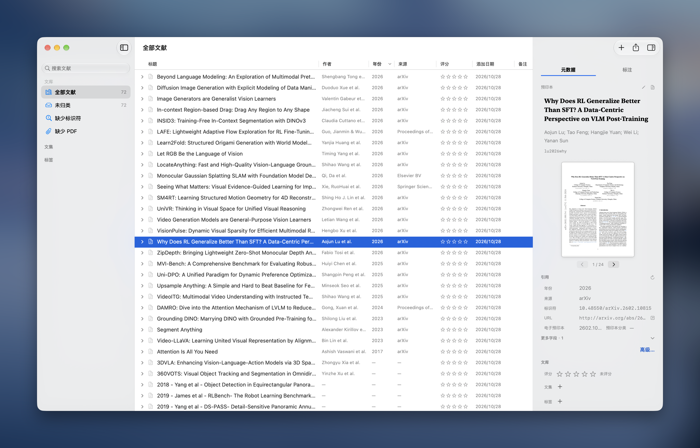
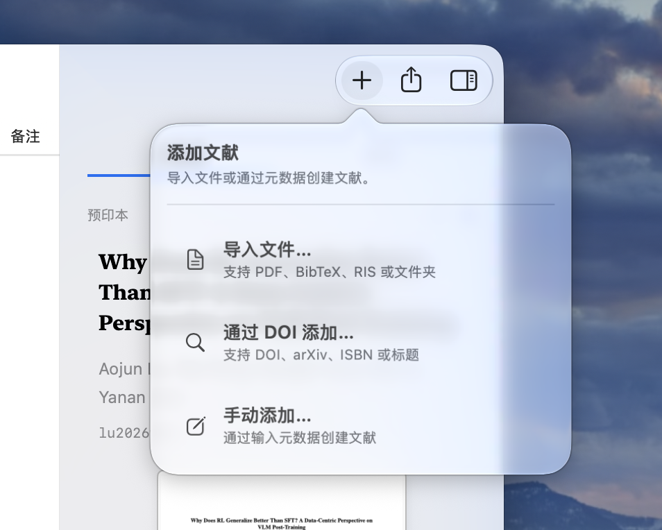
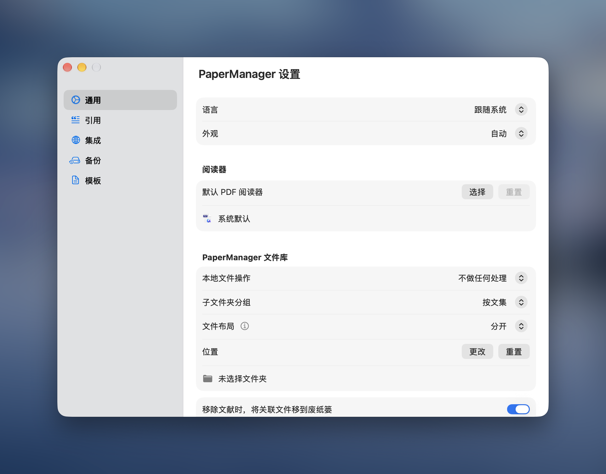

<p align="center">
  
</p>

<h1 align="center">PaperManager</h1>

<p align="center">
  <strong>让文献、笔记与引用，各就其位。</strong><br />
  原生 macOS 文献管理器 · 本地文库 · 中文 / English<br />
  <sub>A native macOS workspace for papers, notes, and citations.</sub>
</p>

<p align="center">
  <a href="https://github.com/get1024/PaperManager/releases/latest"><strong>下载最新 DMG</strong></a> ·
  <a href="#features">功能</a> ·
  <a href="#preview">界面预览</a> ·
  <a href="#development">开发</a> ·
  <a href="https://github.com/get1024/PaperManager/issues">反馈问题</a>
</p>

<p align="center">
  <a href="https://github.com/get1024/PaperManager/releases/latest"></a>
  
  
</p>

[](docs/images/screenshots/library.png)

<p align="center"><sub>macOS 实机截图 · 文献列表、元数据与 PDF 预览</sub></p>

把散落的 PDF 整理成可检索、可引用的文库。PaperManager 将文集、标签、文献列表与元数据编辑放在同一个原生窗口中，帮助你完成从收集资料到整理笔记、导出引用的日常工作。

应用基于 **Swift、AppKit、SwiftUI 和 PDFKit**，文库保存在本地。下载安装包即可使用，无需安装 Node.js 或 Python。

<a id="quick-start"></a>
## 下载与开始使用

1. 前往 [最新发行版](https://github.com/get1024/PaperManager/releases/latest)，下载 DMG；系统与架构要求见该版本说明。
2. 打开 DMG，将 **PaperManager.app** 拖入 **Applications**。
3. 启动应用，导入 PDF、文件夹、BibTeX 或 RIS，或用 DOI / arXiv / ISBN 查询添加文献。

**系统要求：macOS 14 或更新版本，支持 Apple Silicon 与 Intel。** 当前发行包使用临时签名（ad-hoc），尚未经过 Apple 公证；首次打开可能受到 macOS 安全机制拦截。发行页同时提供 SHA-256 校验文件。

已有文库可通过 Zotero 导入或 `.papermanager` 备份迁移。批量整理附件或恢复备份前，建议先导出一份当前文库备份。

<a id="features"></a>
## 从收集到写作

| 工作环节 | PaperManager 提供的能力 |
|---|---|
| **收集文献** | 导入 PDF、文件夹、BibTeX、RIS；按 DOI、arXiv、ISBN 或标题查询；导入前检查元数据与重复项。 |
| **整理文库** | 最多三级文集、彩色标签、评分；管理 PDF 和其他附件，按规则整理或重命名文件。 |
| **查找资料** | 搜索标题、作者、标识符、摘要、备注与自定义字段；支持排序、多选、调整列宽和收起侧栏。 |
| **完善元数据** | 支持 15 种文献类型；直接编辑字段、引用键、摘要与备注，批量刷新在线元数据。 |
| **预览与阅读** | 在文献详情中逐页预览 PDF；通过 Quick Look 或外部阅读器阅读，提取 PDF 标注。 |
| **导出与写作** | 导出 BibTeX、RIS、Markdown；自定义元数据与标注模板，让笔记和引用贴合写作习惯。 |
| **备份与连接** | `.papermanager` 可移植备份、Zotero 导入；可选本地 API、CLI、MCP 和浏览器连接器。 |

<a id="preview"></a>
## 界面预览

<table>
  <tr>
    <td width="50%" align="center"><a href="docs/images/screenshots/add-paper.png"></a></td>
    <td width="50%" align="center"><a href="docs/images/screenshots/settings.png"></a></td>
  </tr>
  <tr>
    <td align="center"><strong>按资料来源添加</strong><br />导入 PDF、BibTeX、RIS 或文件夹，也可查询或手动录入。</td>
    <td align="center"><strong>按自己的习惯设置</strong><br />选择语言、外观、PDF 阅读器与本地文件整理方式。</td>
  </tr>
</table>

以上为 macOS 实机截图。来源与文件说明见[图片说明](docs/images/README.md)。

## 本地数据与备份

- **文库保存在本机。** 文献元数据以本地 JSON 保存；PDF 可保留原位，也可按文件库设置复制或移动。
- **在线查询按需使用。** DOI、arXiv、ISBN 和标题查询会访问 Crossref、arXiv 或 Open Library；相关查询需要联网。
- **备份可以携带附件。** 在设置中导出 `.papermanager` 备份，用于迁移和恢复文库。
- **本地 API 默认关闭。** 启用后仅监听本机 loopback 地址；CLI 默认只读，写入还需应用端允许。

更多路径与备份说明见[数据与目录说明](docs/LOCAL_LAYOUT.md)。

## CLI、MCP 与浏览器

在「设置 → 集成」开启本地 API 后，可通过应用内置 CLI 查询文库，或使用 stdio MCP 接入支持的客户端。设置页支持导出 Agent Skill 和 MCP 配置。

```sh
# 将路径替换为实际安装位置
/Applications/PaperManager.app/Contents/Helpers/PaperManagerCLI status
/Applications/PaperManager.app/Contents/Helpers/PaperManagerCLI search --query transformer
/Applications/PaperManager.app/Contents/Helpers/PaperManagerCLI mcp
```

浏览器连接器以可手动载入的 MV3 源码包提供，支持网页元数据预览和可选 PDF 上传；源码随应用打包。

[集成文档](docs/INTEGRATIONS.md) · [浏览器连接器与安装步骤](BrowserExtension/README.md)

<a id="development"></a>
## 从源码构建

需要 macOS 14+、Xcode 或 Command Line Tools，以及与源码 API 匹配的 macOS SDK。默认构建当前主机架构的 Release 应用。

```sh
git clone https://github.com/get1024/PaperManager.git
cd PaperManager
scripts/build-app.sh
scripts/run-app.sh
```

构建产物为 `dist/PaperManager.app`。如需安装到 `~/Applications`，运行 `scripts/install-app.sh`；安装后 `dist/PaperManager.app` 默认链接到该位置。

<details>
<summary>调试构建与自定义输出</summary>

```sh
PAPERMANAGER_BUILD_CONFIGURATION=debug scripts/build-app.sh
PAPERMANAGER_BUILD_DIR=/tmp/PaperManagerBuild scripts/build-app.sh

# 仅编译 SwiftPM 可执行产品，不生成 .app
scripts/build-swiftpm.sh -c release
```

</details>

### 测试与贡献

```sh
python3 scripts/check-project-membership.py
scripts/test.sh core      # 数据、导入导出、持久化、API、CLI / MCP
scripts/test.sh ui        # 原生布局、表单、选区与编辑
scripts/test.sh ax        # 跨进程辅助功能
```

UI 测试需要 macOS 图形会话，AX 测试需要辅助功能权限。浏览器连接器测试使用 Node.js 18+，工程成员检查使用 Python；这些属于开发依赖。

应用与 CLI 是两个独立编译目标，应用内部按模型、服务、界面和 App Intents 组织。开始贡献前，请阅读[开发说明](docs/DEVELOPMENT.md)、[测试说明](docs/TESTING.md)和[架构与重构约定](docs/REFACTORING.md)。验证改动时使用临时文库；新增源文件需同步更新 Xcode 工程与相关测试入口。

## 当前范围与反馈

PaperManager 已实现本地文献管理、导入导出、备份和本地工具集成。PDF 支持详情预览与外部阅读，不包含内置完整阅读器或阅读时长统计。浏览器连接器仍需手动载入；Safari 签名发行与 Shortcuts 系统注册尚未完成验证。

欢迎在 [Issues](https://github.com/get1024/PaperManager/issues) 提交问题与建议。反馈时请附 macOS 版本、PaperManager 版本和复现步骤；涉及文库内容时，可使用脱敏样例。
