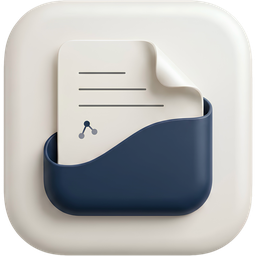
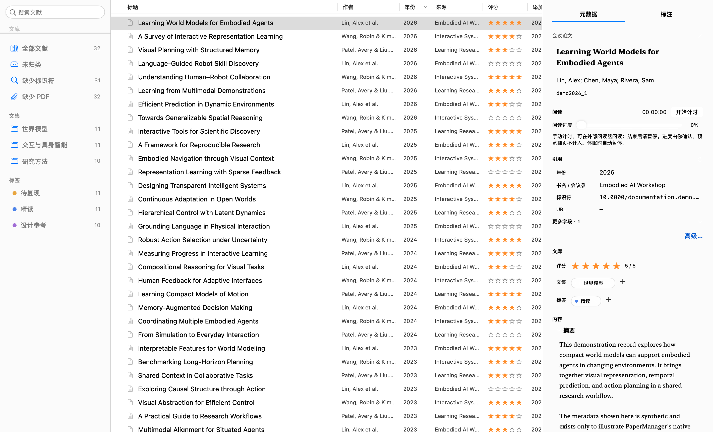
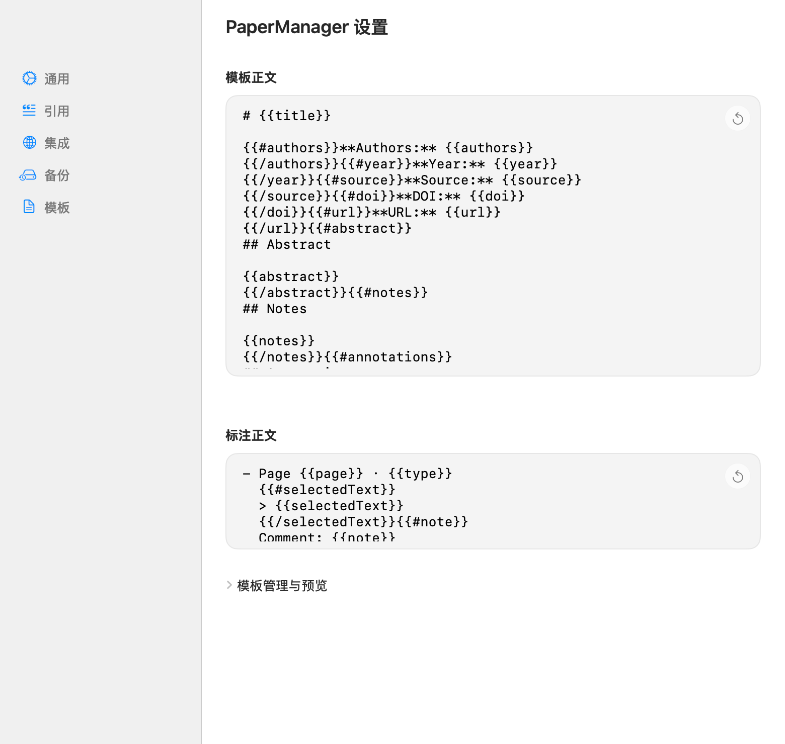
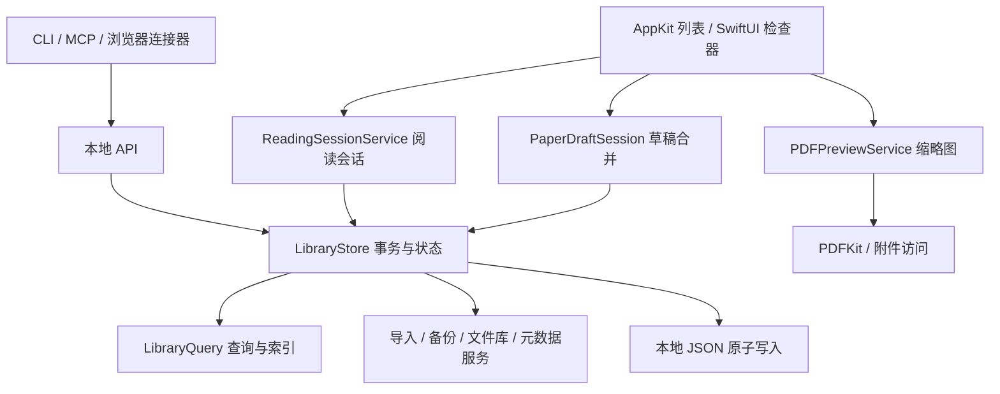

<p align="center">
  
</p>

<h1 align="center">PaperManager</h1>

<p align="center">
  <strong>让文献、笔记与引用，各就其位。</strong><br />
  为 macOS 构建的原生文献管理器。
</p>

<p align="center">
  <a href="#quick-start">快速开始</a> ·
  <a href="#features">功能</a> ·
  <a href="#preview">界面预览</a> ·
  <a href="#development">开发</a> ·
  <a href="https://github.com/get1024/PaperManager/issues">反馈问题</a>
</p>

<p align="center">
  
  
  
</p>

[](docs/images/library.png)

<p align="center"><sub>演示数据 · 基于当前源码生成的原生组件渲染</sub></p>

PaperManager 将收集、整理、检索与引用放进一个原生 macOS 工作空间。用文集和标签组织资料，在检查器中直接编辑元数据，再将所选文献导出到写作工具。

应用使用系统提供的 AppKit、SwiftUI、PDFKit 和 Quick Look，本地文库无需安装 Node.js 或 Python。在线元数据查询会访问 Crossref、arXiv 和 Open Library。

<a id="features"></a>
## 功能

| 从收集到写作 | 你可以做什么 |
|---|---|
| **收集文献** | 导入 PDF、BibTeX、RIS 或文件夹；使用 DOI、arXiv、ISBN 或标题查询；提交前预览并处理重复项。 |
| **整理资料** | 使用最多三级文集、彩色标签和评分组织文库；管理 PDF 与附件，按规则整理或重命名文件。 |
| **快速检索** | 搜索标题、作者、标识符、摘要、备注和自定义字段；排序、多选、调整列宽，独立收起两侧面板。 |
| **完善记录** | 编辑 15 种文献类型，维护引用键、自定义字段、摘要和备注；批量刷新元数据并查看进度。 |
| **阅读与引用** | 在元数据右侧逐页预览 PDF；使用外部阅读器，手动计时并确认阅读进度；提取标注、导出引用。 |
| **迁移与连接** | 使用 `.papermanager` 可移植备份，导入 `.lattice` 或 Zotero 文库；通过可选本地 API、CLI 和 MCP 连接其他工具。 |

<a id="preview"></a>
## 界面预览

<table>
  <tr>
    <td width="50%" align="center"><a href="docs/images/import-preview.png"></a></td>
    <td width="50%" align="center"><a href="docs/images/templates.png"></a></td>
  </tr>
  <tr>
    <td align="center"><strong>确认后再导入</strong><br />先检查元数据与重复项，再决定保留哪些记录。</td>
    <td align="center"><strong>按写作习惯导出</strong><br />自定义元数据模板，让引用与笔记保持一致。</td>
  </tr>
</table>

图中使用独立演示文库；图片由当前生产组件渲染。生成方式与来源记录见[图片说明](docs/images/README.md)。

<a id="quick-start"></a>
## 快速开始

从 [GitHub Releases](https://github.com/get1024/PaperManager/releases/latest) 下载最新 DMG，将应用拖入 Applications。发行包使用临时签名，尚未公证。

**运行要求：macOS 14 或更新版本。** 从源码构建需要可用的 Xcode 或 Command Line Tools，以及与源码 API 匹配的 macOS SDK。

```sh
git clone https://github.com/get1024/PaperManager.git
cd PaperManager
scripts/build-app.sh
scripts/install-app.sh
```

随后从 `~/Applications/PaperManager.app` 启动，或双击仓库中的 **Launch PaperManager.command**。

- 构建产物位于 `dist/PaperManager.app`。默认安装后，该路径成为指向正式应用的链接。
- 正式构建使用 `-Osize` 全模块优化，匹配当前主机架构。
- 本地构建使用临时签名；当前没有提供经过公证的发行包。

<details>
<summary>开发运行、调试构建与自定义输出</summary>

```sh
# 直接启动仓库中的应用；尚未构建时自动构建
scripts/run-app.sh

# 带调试信息构建
PAPERMANAGER_BUILD_CONFIGURATION=debug scripts/build-app.sh

# 输出到指定目录
PAPERMANAGER_BUILD_DIR=/tmp/PaperManagerBuild scripts/build-app.sh

# 仅验证 SwiftPM 可执行产品；此命令不生成 .app
scripts/build-swiftpm.sh -c release
```

更多工具链和路径配置见[开发说明](docs/DEVELOPMENT.md)。

</details>

## 数据与备份

文库以本地 JSON 保存。首次使用采用应用默认位置；选择其他文库后，启动时会沿用有效的偏好路径。PDF 可以保留原位，也可以按文件库设置复制或移动。

检查器中的元数据编辑在原子写盘成功后才发布成功状态；写入失败保留草稿。恢复和文件整理会检查并发变更；文件操作失败时尝试回滚，并报告未能完成的部分。迁移或批量整理前，建议先在设置中导出一份 `.papermanager` 备份。

个人文库、PDF、备份和凭据不进入源码仓库。路径规则见[数据与目录说明](docs/LOCAL_LAYOUT.md)。

## CLI、MCP 与浏览器

本地 API **默认关闭**。在「设置 → 集成」启用后，可以开启只读模式并调整端口。CLI **默认只读**；写操作还必须得到应用端允许。

```sh
dist/PaperManager.app/Contents/Helpers/PaperManagerCLI status
dist/PaperManager.app/Contents/Helpers/PaperManagerCLI search --query transformer
dist/PaperManager.app/Contents/Helpers/PaperManagerCLI mcp
```

设置页支持导出 Agent Skill 和 MCP 配置。浏览器连接器提供可手动载入的 MV3 源码包，支持页面元数据预览和可选 PDF 上传。

[集成文档](docs/INTEGRATIONS.md) · [浏览器连接器](BrowserExtension/README.md)

<a id="development"></a>
## 开发

```sh
scripts/test.sh core      # 数据、导入导出、持久化、API、CLI / MCP
scripts/test.sh ui        # 原生布局、表单、选区与编辑
scripts/test.sh ax        # 跨进程辅助功能
scripts/clean.sh          # 清理中间产物，保留最新测试日志
```

UI 测试需要 macOS 图形会话；AX 测试还需已有的辅助功能权限。连接器测试使用 Node.js 18+，工程成员检查使用 Python；这些都是开发工具，不是应用运行依赖。

```text
Sources/
├── PaperManager/
│   ├── Models/       文献、组织关系与设置
│   ├── Services/     查询、持久化、导入导出与集成
│   ├── Views/        原生界面与窗口协调
│   └── Intents/      App Intents
└── PaperManagerCLI/  CLI 与 stdio MCP
Tests/               隔离文库、原生 UI 与连接器回归
scripts/             构建、启动、测试与维护入口
```

### 架构与参与开发

应用当前采用 **按职责分层的单体架构**：App 与 CLI 是两个独立编译目标，App 内部按模型、服务、界面组织。目录划分提供清晰入口，但尚未由独立 Swift Package 强制隔离依赖；新增功能应继续收窄边界。



| 修改需求 | 从这里开始 | 边界与约定 |
|---|---|---|
| 字段与兼容性 | `Models/LibraryModels.swift`、`ReadingRecord.swift` | 新增可选字段兼容旧文库；模型不调用界面或网络。 |
| 查询与排序 | `Services/LibraryQuery.swift` | 数据计算不直接更新界面或写盘。 |
| 持久化与操作协调 | `Services/LibraryStore.swift` | 先原子写盘，再发布状态；失败保留可恢复数据。 |
| PDF 缩略图 | `Services/PDFPreviewService.swift`、`Views/PaperReadingView.swift` | 后台渲染单页、限制图像大小；取消的请求不能回填到新条目。 |
| 阅读时间与进度 | `ReadingSessionService.swift`、`ReadingRecord.swift` | 每个文库共用一个显式计时会话；从最新记录合并，避免覆盖草稿。 |
| 列表与侧栏 | `Views/NativeLibrary*.swift` | AppKit 管理复用、选区、键盘与辅助功能；回调交给服务执行。 |
| 元数据编辑 | `Views/PaperDetailView.swift`、`InspectorInlineEditor.swift` | 草稿和提交分开；延迟编辑只合并用户修改的字段。 |
| 外部工具 | `Sources/PaperManagerCLI`、`Services/LocalAPIServer.swift` | CLI 通过 HTTP 协议访问应用，不直接改写文库 JSON。 |

2026-10-28 架构审核：列表、查询、文件服务已具备独立职责；本版将阅读模型、计时、PDF 渲染与阅读控件分别放入四个文件。主要耦合仍集中在 `LibraryStore`（约 1,300 行）、`PaperDetailView` 和 `SettingsView`（各约 1,300 行）；若继续增加功能，应按用例拆出协调器、检查器小节和设置页面，并为文件与网络边界注入接口。现有部分测试手动枚举源文件，也是后续统一测试目标时应消除的维护成本。这里不会把目录分层宣称为已经完成的包级模块化。

第一次贡献可以按以下步骤完成：

1. 在对应目录找到入口，先运行该功能的 `scripts/test-*.sh`，确认已有行为。
2. 将业务规则写入模型或服务，界面只保存短期交互状态并调用服务；避免新增全局可变状态和直接 JSON 写入。
3. 新增源文件同步登记 Xcode 工程及相关测试脚本，运行 `python3 scripts/check-project-membership.py`。
4. 用临时文库验证改动，执行 `scripts/test.sh core`；涉及界面时加跑 `ui` 与 `ax`。不要用个人文库做写入测试。
5. 提交小而完整的改动，说明用户行为、兼容性、测试结果和未验证范围。

### 阅读记录的使用范围

标题、作者和引用键右侧显示 PDF 缩略图，下方是原生上一页／下一页按钮。预览只渲染图片，不提供内部 PDF 阅读器；缺失、损坏或加密文件显示不可用状态。

点击「开始计时」后可以切换到任何外部阅读器，结束后点击「暂停计时」。同一文库同时只计时一篇；切换列表选择不会改变正在计时的论文。每 5 秒保存一次，暂停和正常退出补存尾段，电脑休眠时暂停；异常退出可能损失最后不足 5 秒。外部阅读器关闭、切换文档或用户离开不会自动停止这个手动会话。

进度通过滑块确认，也可点击「标记已读至当前预览页」；百分比表示用户确认的阅读位置，不是逐页覆盖率或理解程度。仅打开附件或翻预览不会自动增加进度。记录保存在文库和可移植备份中；不从外部阅读器猜测页码。

实现研究见 [Zotero Style 阅读统计对照](docs/READING.md)。

[开发说明](docs/DEVELOPMENT.md) · [测试说明](docs/TESTING.md) · [重构约定与本轮验证](docs/REFACTORING.md)

## 当前状态

核心文献管理、导入导出、备份和本地集成已经实现。浏览器连接器仍以源码包交付；Safari 签名发行和 Shortcuts 系统注册尚未完成验证。
